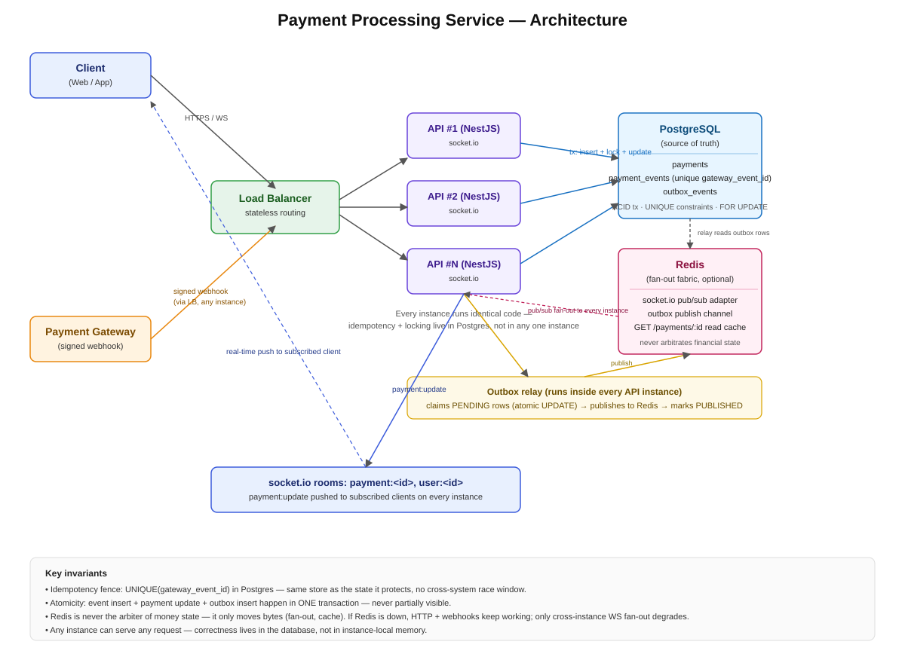

# Payment Service — Architecture Diagram



## System overview (ASCII walkthrough of the same diagram)

```
┌──────────────┐   HTTPS (REST) / WS (JWT)   ┌──────────────────────┐
│   Client     │────────────────────────────▶│   Load Balancer      │
│  (Web/App)   │◀────────────────────────────│  (NLB / HAProxy)     │
└──────────────┘                             └──────────┬───────────┘
                                                        │
                ┌───────────────────────────────────────┼───────────────────────────────────────┐
                ▼                                       ▼                                       ▼
          ┌───────────┐                           ┌───────────┐                           ┌───────────┐
          │  API #1   │                           │  API #2   │                           │  API #N   │
          │ (NestJS)  │                           │ (NestJS)  │                           │ (NestJS)  │
          │ socket.io │                           │ socket.io │                           │ socket.io │
          └─────┬─────┘                           └─────┬─────┘                           └─────┬─────┘
                │   ┌───────────────────────────────────┴─────────────────────────────────────┤
                │   │  Every instance runs the SAME code:                                    │
                │   │   · webhook idempotency = DB UNIQUE constraint (ON CONFLICT)           │
                │   │   · payment row serialized with SELECT ... FOR UPDATE                  │
                │   │   · outbox relay (lease-based claim, publish → Redis)                  │
                │   └───────────────────────────────────────────────────────────────────────┘
                │
      ┌─────────▼──────────┐   pub/sub               ┌──────────────────────┐
      │     PostgreSQL      │◀────────────────────────▶│        Redis         │
      │  (source of truth)  │    payment.events        │  · socket.io adapter │
      │                     │──────────────────────────▶│  · outbox channel    │
      │  payments           │   (outbox relay publish) │  · cache / rate-limit│
      │  payment_events     │                          └──────────┬───────────┘
      │  outbox_events      │                                     │ (fan-out to all instances)
      └─────────────────────┘                                     │
                                                                  │
                     ┌──────────────┐   signed webhook, retries   │
                     │ Payment GW   │─────────────────────────────┼──▶ LB ─▶ any API instance
                     │ (Stripe etc.)│                             ▼
                     └──────────────┘                    socket.io rooms:
                                                         payment:<id>, user:<id>
```

## Component responsibilities

| Component | Responsibility |
|---|---|
| **Client** | REST for CRUD, WebSocket for live updates. Subscribes with a JWT to `payment:<id>` / `user:<id>` rooms. |
| **Load Balancer** | Distributes HTTP + WS traffic across instances. Stateless routing — any instance can serve any request. |
| **API instance (NestJS)** | Validates, executes the webhook transaction, runs the outbox relay, hosts the socket.io gateway. All instances are symmetric; no sticky state except in-flight sockets. |
| **PostgreSQL** | Source of truth for all financial state. Enforces idempotency (unique index), status transitions (CHECK), and atomicity (transactions). |
| **Redis** | Cross-instance fan-out fabric: socket.io pub/sub adapter + the outbox relay channel. Never arbitrates money state. |

## Key interaction flows

### 1. Create payment
```
Client ──POST /payments──▶ LB ──▶ API#N
   API#N opens TX:
     INSERT payments (status=PENDING)
     INSERT outbox_events (payment.created)
   COMMIT
   API#N ──201──▶ Client
   outbox relay (any instance) claims row, publishes to Redis `payment.events`
```

### 2. Webhook (status change)
```
Gateway ──signed POST /webhooks/payment──▶ LB ──▶ API#K
   API#K verifies HMAC-SHA256 (raw body + timestamp window)
   BEGIN:
     INSERT payment_events ... ON CONFLICT (gateway_event_id) DO NOTHING
       → 0 rows ⇒ duplicate ⇒ COMMIT, return disposition:"duplicate"
     SELECT * FROM payments WHERE id=$1 FOR UPDATE     -- serialize this payment
     state-machine gate (terminal states never mutate)
     UPDATE payments SET status=<target>
     INSERT outbox_events (payment.succeeded)
   COMMIT
   outbox relay publishes to Redis
   Redis pub/sub adapter delivers to EVERY instance's socket.io
   instance holding subscribed sockets emits payment:update
```

### 3. Real-time update
```
[DB] outbox row → [Redis channel] → [all API instances] → socket.io rooms → clients
```

## Consistency boundaries

- **Idempotency fence** = `UNIQUE(gateway_event_id)` in PostgreSQL (same store as the state it protects — no cross-system TOCTOU).
- **Create idempotency** = `UNIQUE(client_request_id)` in PostgreSQL.
- **Atomicity** = one database transaction per mutation; outbox row is committed with the state change, so the event never "happens" before its data is durable.
- **Ordering/fan-out** = Redis pub/sub; at-least-once, idempotent downstream (WebSocket snapshot on subscribe).

*Full schema with rationale: `src/database/migrations/001-initial-schema.sql`.*
